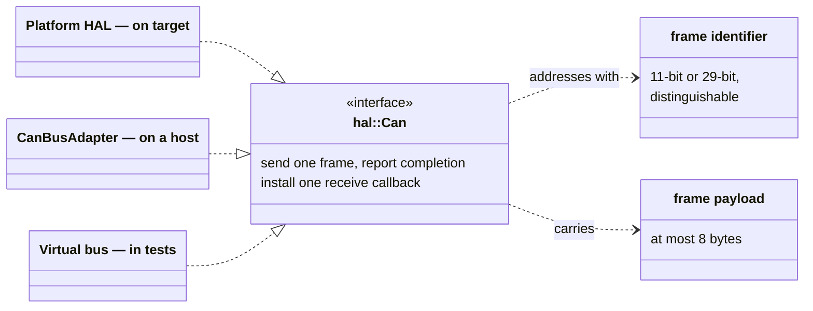
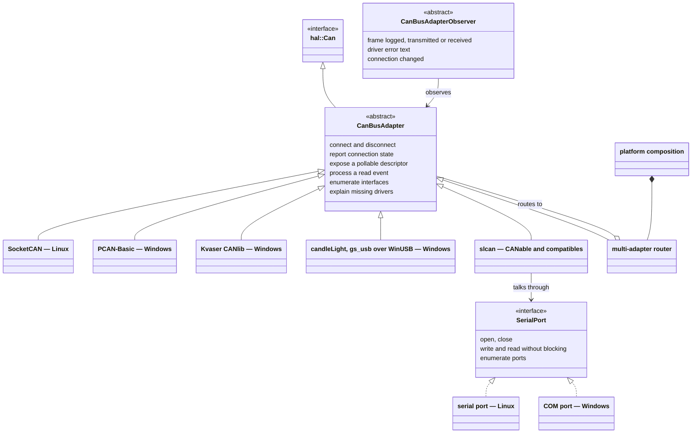
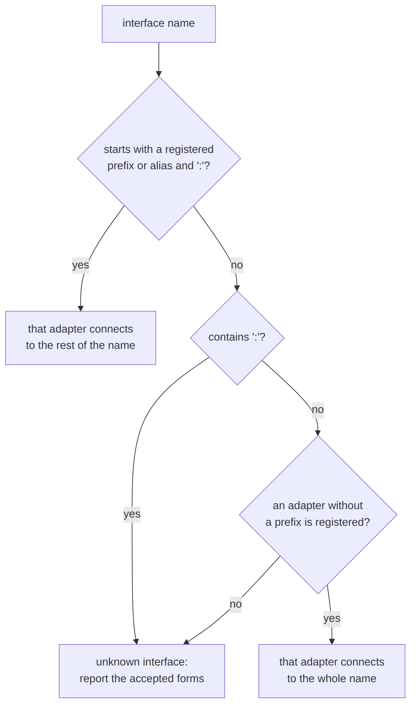

# HAL and Bus Drivers

The bottom of the stack is deliberately thin. can-lite asks the hardware for
exactly two things — send a frame, deliver a received frame — and everything
above is written against those two and nothing else.

## 1. What the library requires of a bus

Four properties of that contract shape every layer above it:

| Property                                               | Consequence                                                                                                                                                         |
|--------------------------------------------------------|---------------------------------------------------------------------------------------------------------------------------------------------------------------------|
| A payload is at most 8 bytes                           | Anything longer needs segmentation (Chapter 8), and payload composition is bounds-checked against the frame (Chapter 4)                                             |
| Sending is asynchronous, completing through a callback | The core layer keeps its own queue and serialises sends (Chapter 4)                                                                                                 |
| Exactly one receive callback exists per interface      | The protocol object claims it at construction; a second consumer of the same bus is not supported                                                                   |
| Identifier widths are distinguishable                  | can-lite uses extended identifiers exclusively and discards standard-identifier frames unseen, which is what lets it share a bus with other protocols (REQ-CAN-002) |

The library neither provides nor requires a particular implementation. On a
microcontroller the platform HAL supplies one; the library takes a reference to
it when the protocol object is constructed.

## 2. The host adapter

Host-side tooling needs more than the bus interface offers: opening an
interface, reporting connection state, enumerating what the machine has,
explaining what is missing, and integrating with a poll loop. The adapter
interface adds exactly that — and nothing the protocol layer would ever call.

| Adapter       | Platform       | Interface names                           | Needs on the machine                                   | Bitrates                                        |
|---------------|----------------|-------------------------------------------|--------------------------------------------------------|-------------------------------------------------|
| SocketCAN     | Linux          | the network interface, `can0`             | the CAN kernel modules                                 | whatever the controller's kernel driver can hit |
| slcan         | Linux, Windows | the serial port, `/dev/ttyACM0` or `COM3` | nothing beyond the operating system's serial driver    | the nine Lawicel rates, 10 kbit/s to 1 Mbit/s   |
| candleLight   | Windows        | `1`, `2`, … in enumeration order          | WinUSB, which candleLight firmware binds automatically | any rate the controller's clock divides exactly |
| PCAN-Basic    | Windows        | `1` to `16`, the USB channel              | the PEAK-System driver package (`PCANBasic.dll`)       | the same nine rates as slcan                    |
| Kvaser CANlib | Windows        | `0`, `1`, …                               | the Kvaser CANlib driver (`canlib32.dll`)              | CANlib's predefined rates: no 20 or 800 kbit/s  |

Vendor libraries are loaded when an adapter connects or enumerates, never
linked, and released through the vendor's own unload call where it has one. Every adapter therefore builds without a vendor SDK, and a machine
without the vendor driver gets an explanation instead of a failure to start.
The pure parts — slcan line encoding and decoding, gs_usb host frames and the
bit-timing search — live in a codec library with no platform dependency, so the
host test suite covers them on every platform.

Each platform-specific adapter is guarded both in the build and in its header,
so including the wrong one for a platform yields an empty translation unit
rather than a compile error.

The observer interface exists for tooling — a bus monitor attaches to it and
receives every frame in both directions, driver error text, and connection
transitions. It is an observation channel, not a data path: the protocol still
receives frames through the bus interface.

**Extended identifiers only.** Every adapter delivers and transmits 29-bit
frames only; standard-identifier, remote and error frames stop at the driver,
consistent with the protocol rule (REQ-CAN-002). A send with a standard
identifier completes unsuccessfully.

**Missing drivers.** An adapter reports a plain-language reason for each driver
it needs but cannot find — for example the kernel modules SocketCAN needs, or
the vendor library PCAN-Basic loads. An adapter that needs nothing reports
nothing.

**Poll-loop integration.** The adapter exposes a descriptor to select on and an
entry point to call when it becomes readable, so a host application can service
the bus from its own loop instead of dedicating a thread to it. On Linux the
descriptor is a file descriptor. On Windows it is a waitable handle where the
driver offers one — candleLight, and PCAN when its receive event could be
installed — and −1 otherwise: Kvaser, and slcan, whose COM port offers no event.
Calling the read entry point from a timer is always safe, because every adapter
reads without blocking and bounds the work done per call. Adapters also defer their send completions through the event
dispatcher rather than calling them from inside the send. That detail matters
more than it looks: it guarantees the core layer's queue is never re-entered
from inside its own send (Chapter 10, §2).

### 2.1 Several adapters behind one name

A tool that should work with whatever adapter is plugged in composes the
adapters behind the multi-adapter router. Each adapter is registered with a
prefix, optionally an alias, and at most one adapter is registered without a
prefix. Interface names take the form `prefix:channel`; the router hands the
channel to the adapter that owns the prefix.

Only the adapter being connected is active. Its frames, errors and connection
changes reach the router's observer and receiver; the others stay silent. When
the active adapter reports that its connection was lost, the router forgets it.
Interfaces are enumerated with their prefix, so the names a tool offers are the
names it can connect to.

Missing drivers are reported only when no registered adapter is usable — usable
meaning its drivers are present and it has at least one interface. Then every
adapter's reasons are reported together, which is what a user needs to see when
nothing works; while one adapter works, a missing vendor driver for another is
not worth mentioning.

The platform composition registers the set for the build platform:

| Platform | Registered adapters                                                             |
|----------|---------------------------------------------------------------------------------|
| Linux    | SocketCAN without a prefix, slcan as `slcan:` with the alias `CANable:`         |
| Windows  | `PCAN:`, `Kvaser:`, slcan as `slcan:` with the alias `CANable:`, `candleLight:` |

### 2.2 SocketCAN, slcan and candleLight specifics

SocketCAN checks the interface before touching it, then sets the bitrate over
the kernel's routing netlink, the interface `ip link` itself uses: the link is
taken down, given the new bit timing and brought back up. It does this only for
a CAN controller that is not already up at that bitrate, so a virtual CAN
interface, which has no bit timing, is left alone, and so is an interface an
administrator configured beforehand. Changing the bitrate needs root or
`CAP_NET_ADMIN`; a refusal is reported and the connection refused, rather than
the bus opening at a rate nobody asked for. Each read call drains up to 256
frames; remote and error frames are dropped.

slcan opens a channel with three commands: close, select the bitrate, open.
Connecting writes them and returns; the adapter reports itself connected only
once the device has acknowledged the bitrate and the open command. A device
that is already closed rejects the first command, so the answer to that close is
ignored. A rejection of either of the others, or a second of silence, closes the
port, says why and reports the connection lost — so a serial port that is not
an slcan device does not appear to connect. The handshake is timed, which is why
the slcan adapter needs the timer service, as the protocol objects do.
Rejections after the channel is open are reported as errors. When the serial
port cannot be opened the reason is named — not found, in use, or access denied
(on Linux the user must be in the `dialout` group). A write the port cannot take
in one piece is finished within 100 ms or fails, so a command is never left
half-written on the line.

candleLight adapters describe their CAN controller's timing limits. The adapter
searches those limits for timing that divides the controller clock exactly into
the requested bitrate with the sample point closest to 87.5 %, and refuses a
bitrate it cannot hit exactly.

## 3. The virtual bus used by the integration tests

The integration tests replace hardware with a pair of connected virtual buses:
one instance's send lands in the other's receive callback, which models the
two-node topology the tests use. A second entry point pushes a frame straight
into the receive callback, bypassing the peer — that is how a test produces
something no correct peer would ever send: a malformed acknowledgement, a wrong
sequence number, an unknown category, a standard-identifier frame. Disconnecting
models bus loss, which is how the liveness timeouts of Chapters 6 and 7 are
exercised.

What the virtual bus does **not** model is the boundary of what the integration
tests can prove:

| Not modelled                      | Consequence for testing                                                                      |
|-----------------------------------|----------------------------------------------------------------------------------------------|
| Arbitration and priority          | Frame order is send order, so priority effects are reasoned about (Chapter 11), not observed |
| Bus errors, error frames, bus-off | Sending always succeeds; failure paths are exercised through mocks instead                   |
| Transmission delay and bit timing | Bus-load budgeting is arithmetic, not measurement                                            |
| More than two endpoints           | Multi-server behaviour is covered at the unit level                                          |

## 4. What can-lite assumes of a driver

A driver that satisfies the interface but breaks any of these produces
protocol-level misbehaviour rather than an obvious failure, so they are worth
stating:

1. **Each send completes exactly once, and not from inside the send call
   itself.** The core layer dequeues the next frame from within that completion;
   a synchronous completion turns queue drain into recursion.
2. **Whole frames are delivered**, with the identifier already separated from
   the payload.
3. **The receive callback runs in the application's own context.** A driver that
   calls it from an interrupt must marshal through the event dispatcher first.
4. **Frames arrive in the order they were received.** Sequence validation
   rejects reordered commands, so a reordering driver produces spurious sequence
   errors.
5. **Acceptance filtering, if configured, must admit the broadcast address.**
   The client's heartbeat is broadcast; a filter that matches only the node's
   own address will make the server report its client offline on an idle bus.

Point 5 is the one that bites during MCU integration, and it is catalogued in
Chapter 10, §6.
