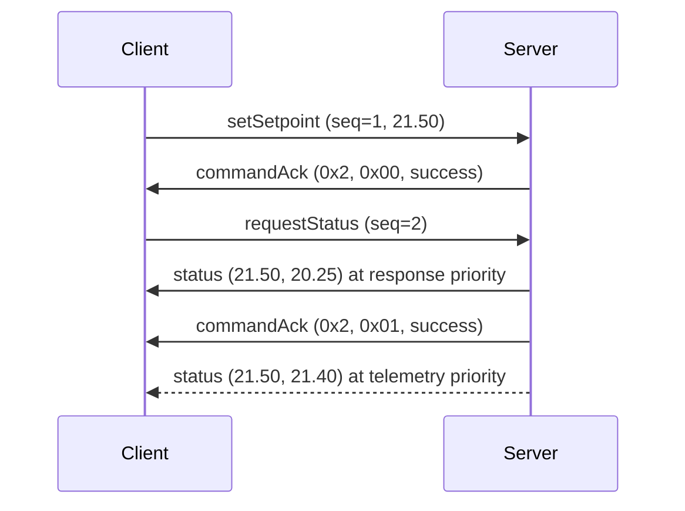

# Setpoint — Example Category Specification

**Category ID:** 0x2  
**Extends:** [can-protocol.md](../../../documents/spec/can-protocol.md)  
**Status:** Example

## 1. Overview

The Setpoint category is the smallest category that still shows every part of
the pattern: a client commands a device to a target value, asks for the
device's status, and receives that status either as the answer to its request
or as unsolicited telemetry. The domain is deliberately generic — the target
could be a temperature, a pressure or a fan speed — so the example carries no
application knowledge to keep in sync with any product.

The category requires sequence validation on every command (byte 0 is the
sequence number, see the main specification). Command acknowledgements use the
System category's `commandAck`; the category defines no rejection frame of its
own.

## 2. Values

Both the setpoint and the measurement are big-endian signed 16-bit fixed-point
values with scale factor 100 (resolution 0.01, range ±327.67), converted as the
main specification describes. Their unit is the application's choice.

## 3. Commands (Client → Server)

Both commands are sent at `CanPriority::command`.

### 3.1 Set Setpoint (0x00)

| Byte | Field    | Type  | Scale | Description      |
|------|----------|-------|-------|------------------|
| 0    | Sequence | uint8 | —     | Sequence counter |
| 1–2  | Setpoint | int16 | 100   | Target value     |

The server passes the decoded value to its observer and acknowledges the
command with the status the observer reports, so the application can refuse a
value it cannot accept. A payload shorter than 3 bytes is acknowledged as
`invalidPayload` without reaching the observer.

### 3.2 Request Status (0x01)

| Byte | Field    | Type  | Description      |
|------|----------|-------|------------------|
| 0    | Sequence | uint8 | Sequence counter |

The server asks its observer for the current status, then sends a Status
response (0x81) followed by a successful acknowledgement.

## 4. Responses (Server → Client)

### 4.1 Status (0x81)

| Byte | Field       | Type  | Scale | Description           |
|------|-------------|-------|-------|-----------------------|
| 0–1  | Setpoint    | int16 | 100   | Active target value   |
| 2–3  | Measurement | int16 | 100   | Latest measured value |

The frame is sent at `CanPriority::response` when it answers Request Status,
and at `CanPriority::telemetry` when the application publishes it on its own.
The client decodes both cases identically and notifies its observer; it
rejects a payload shorter than 4 bytes.

## 5. Typical Flow

